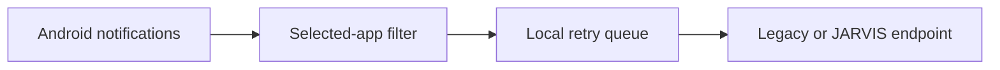

# Legacy Link

Legacy Link is a lightweight Android companion app that forwards notifications from apps you choose to Legacy AI, JARVIS, or another self-hosted assistant on your computer.

The phone connects directly to your assistant's HTTP endpoint. A private Tailscale network is recommended so notifications are not exposed to the public internet.

## Features

- Opt-in app selection: no notification source is enabled by default.
- QR or manual pairing with your assistant's address and shared secret.
- Offline queue for up to 200 notifications while the computer is unavailable.
- Automatic retry when the listener reconnects, the app opens, or the phone restarts.
- Master switch to pause all forwarding.
- No analytics, ads, cloud database, or third-party notification relay.
- Android 8.0 and newer (`minSdk 26`).



## Quick start

1. Create a new GitHub repository named `legacy-link`.
2. Upload the **contents** of this folder to the repository root.
3. Open the repository's **Actions** tab and run **Build Legacy Link APK**.
4. Download the `legacy-link-debug-apk` artifact and install `app-debug.apk` on your Android phone.
5. Connect the phone and computer to the same Tailscale account.
6. Open Legacy Link, grant notification access, pair it with the assistant, and choose the apps to mirror.

See [INSTALL_GUIDE.md](INSTALL_GUIDE.md) for the full setup and troubleshooting steps.

## Assistant API

Your Legacy AI or JARVIS server needs two routes:

- `GET /phone-ping` returns a successful `2xx` response.
- `POST /phone-notify` accepts JSON and verifies the `X-Legacy-Secret` header.

Example payload:

```json
{
  "app": "com.example.app",
  "appLabel": "Example",
  "title": "New message",
  "text": "Notification body",
  "at": 1787000000000
}
```

The complete integration contract and a small Node.js example are in [SERVER_API.md](SERVER_API.md).

## Build locally

The project uses Kotlin, Android Gradle Plugin 8.5.2, Gradle 8.9, and Java 17.

The complete, checksum-verified Gradle wrapper is included. Open the repository root in Android Studio, or build from a terminal:

```bash
./gradlew lintDebug assembleDebug
```

On Windows, use `.\gradlew.bat lintDebug assembleDebug`. See [BUILD_IN_ANDROID_STUDIO.md](BUILD_IN_ANDROID_STUDIO.md) for details.

## Privacy and security

Notifications can contain private messages, one-time codes, and financial information. Only select sources you genuinely want your assistant to receive.

- The app is private-by-default and forwards nothing until apps are selected.
- The pairing secret is stored in the app's private preferences and Android backup is disabled.
- Redirects are not followed, preventing notification data or the secret from being forwarded to another host.
- Plain HTTP is supported for Tailscale use. Do not expose the receiver port directly to the public internet.
- Rotate the pairing secret if it is ever shared, logged, or committed.

For responsible disclosure guidance, see [SECURITY.md](SECURITY.md).

## Repository layout

| Path | Purpose |
| --- | --- |
| `app/` | Android application source and resources |
| `.github/workflows/build-apk.yml` | GitHub Actions lint and APK build |
| `gradle/`, `gradlew*` | Checksum-verified Gradle wrapper |
| `SERVER_API.md` | Assistant-side HTTP integration contract |
| `INSTALL_GUIDE.md` | Phone, Tailscale, and pairing setup |

## Distribution note

GitHub Actions produces a debug-signed APK for testing and personal sideloading. A public or store release should use a private production signing key and a separate signed-release workflow.

## License

Copyright © 2026 Shahyd Legacy. This project is supplied under the proprietary terms in [LICENSE](LICENSE); no open-source license is granted.
