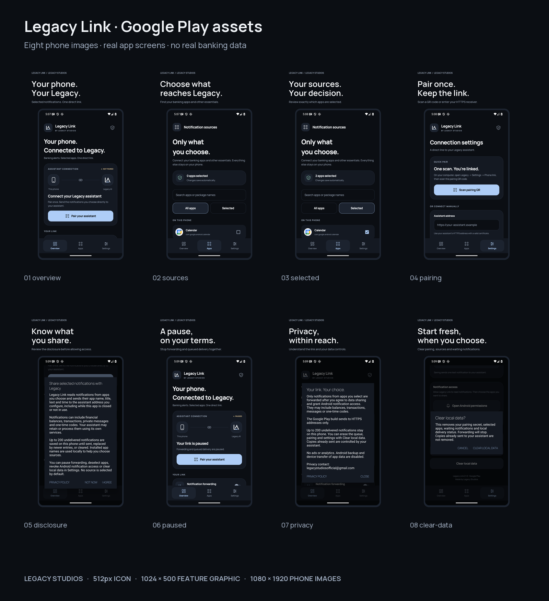
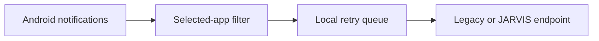

# Legacy Link 2.1

Legacy Link is a lightweight Android companion app that forwards notifications from apps you choose to Legacy AI, JARVIS, or another self-hosted assistant on your computer.

The phone connects directly to your assistant. The Google Play build requires HTTPS. A separate personal build supports HTTP over an appropriately encrypted private network such as Tailscale.

The Legacy Studios interface includes native Overview / Apps / Settings navigation, searchable sources, an adaptive L / angular-A icon, explicit notification-sharing consent, a privacy-policy link and local-data controls.

**[Google Play submission kit](play-store/README.md)** · **[Personal APK](play-store/builds/Legacy-Link-2.1.0-personal.apk)** · **[Play AAB](play-store/builds/Legacy-Link-2.1.0-play.aab)** · **[Notification access help](NOTIFICATION_ACCESS.md)**

[Privacy policy](https://shahydlegacyofficial-creator.github.io/legacy-Link/privacy.html) · [Support](https://shahydlegacyofficial-creator.github.io/legacy-Link/) · [Data deletion](https://shahydlegacyofficial-creator.github.io/legacy-Link/deletion.html)



## Features

- Opt-in app selection: no notification source is enabled by default.
- QR or manual pairing with your assistant's address and shared secret.
- Offline queue for up to 200 notifications while the computer is unavailable.
- Automatic retry when the listener reconnects, the app opens, or the phone restarts.
- Master switch to pause all forwarding.
- No analytics, ads, cloud database, or third-party notification relay.
- Android 8.0 and newer (`minSdk 26`).



## Quick start

1. Install the personal APK from the link above, or use a future Play testing/production release. The Play kit prepares the upload; it does not claim an approved store listing.
2. Use a reachable HTTPS assistant receiver for the Play build, or an encrypted private network for the personal build.
3. Pair, review the notification-sharing disclosure, grant Android notification access, and choose the apps to mirror.

If Android says “App was denied access”, see [the restricted-settings guide](NOTIFICATION_ACCESS.md). Version 2.1 adds Settings → Notification access blocked? → Open App info. Android's approval remains under the device owner's control.

See [INSTALL_GUIDE.md](INSTALL_GUIDE.md) for the full setup and troubleshooting steps.

## Assistant API

Your Legacy AI or JARVIS server needs two routes:

- `GET /phone-ping` returns a successful `2xx` response.
- `POST /phone-notify` accepts JSON and verifies the `X-Legacy-Secret` header.

Example payload:

```json
{
  "app": "com.example.app",
  "appLabel": "Example",
  "title": "New message",
  "text": "Notification body",
  "at": 1787000000000
}
```

The complete integration contract and a small Node.js example are in [SERVER_API.md](SERVER_API.md).

## Build locally

The project uses Kotlin 2.2.20, Android Gradle Plugin 8.13.0, Gradle 8.14.3, Android SDK 36 and Java 17 or a compatible JDK.

The complete, checksum-verified Gradle wrapper is included. Open the repository root in Android Studio, or build from a terminal:

```bash
./gradlew testPersonalDebugUnitTest testPlayDebugUnitTest lintPersonalDebug lintPlayDebug assemblePersonalDebug
```

On Windows, use `.\gradlew.bat` with the same tasks. See [BUILD_IN_ANDROID_STUDIO.md](BUILD_IN_ANDROID_STUDIO.md) for details. The personal APK is written to `app/build/outputs/apk/personal/debug/app-personal-debug.apk`. For a signed Play release, run `python tools/build_play_release.py`; see [signing instructions](play-store/documentation/BUILD_AND_SIGNING.md).

## Privacy and security

Notifications can contain private messages, one-time codes, and financial information. Only select sources you genuinely want your assistant to receive.

- The app is private-by-default and forwards nothing until disclosure is accepted, Android access is granted, and sources are selected.
- The pairing secret is stored in the app's private preferences and Android backup is disabled.
- Redirects are not followed, preventing notification data or the secret from being forwarded to another host.
- The Play flavor requires HTTPS; the personal flavor supports private-network HTTP. Do not expose an unencrypted receiver directly to the public internet.
- Clear local data removes pairing, selected sources, queue, consent and local status; independent receiver copies must be deleted there.
- Rotate the pairing secret if it is ever shared, logged, or committed.

For responsible disclosure guidance, see [SECURITY.md](SECURITY.md).

## Repository layout

| Path | Purpose |
| --- | --- |
| `app/` | Android application source and resources |
| `tools/emulator_smoke.py` | Actual-APK emulator checks with synthetic notifications |
| `design/` | Vector icon, preview, font license, and QA screenshots |
| `play-store/` | Submission documents, graphics, signed upload bundle and verification |
| `docs/` | Static GitHub Pages privacy/support/deletion website |
| `gradle/`, `gradlew*` | Checksum-verified Gradle wrapper |
| `SERVER_API.md` | Assistant-side HTTP integration contract |
| `INSTALL_GUIDE.md` | Phone, Tailscale, and pairing setup |

## Distribution note

The personal APK is debug-signed for sideloading. The Play AAB/APK are signed with a separate private upload key. The key and passwords stay outside this repository; only the public upload certificate is included. Developer-account setup, reviewer receiver access, final Data safety certification and any required closed testing remain owner actions in Play Console.

## License

Copyright © 2026 Shahyd Legacy. This project is supplied under the proprietary terms in [LICENSE](LICENSE); no open-source license is granted.
